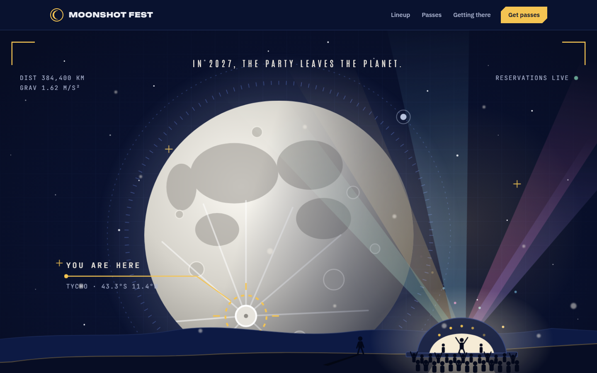
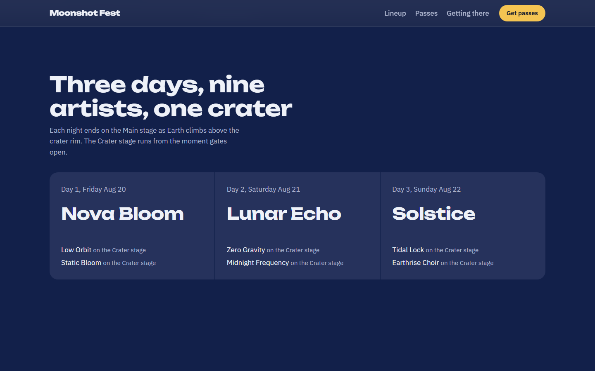
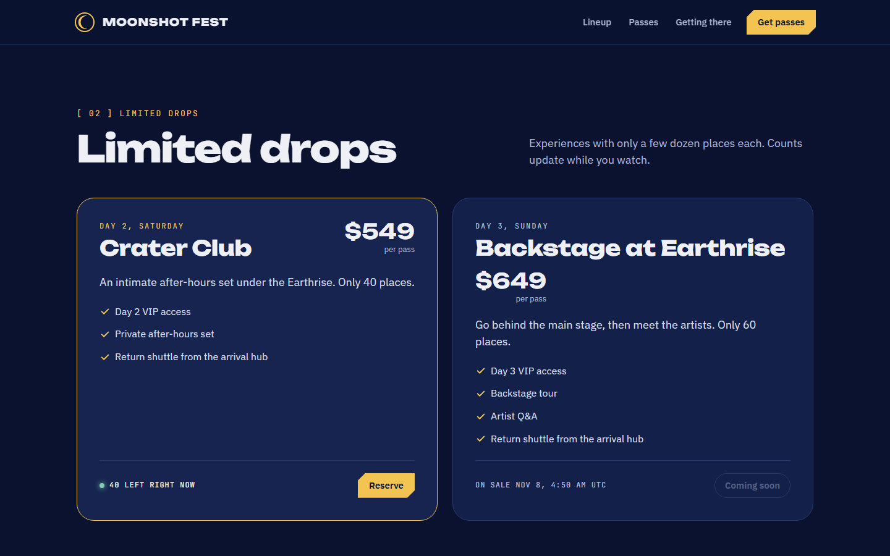
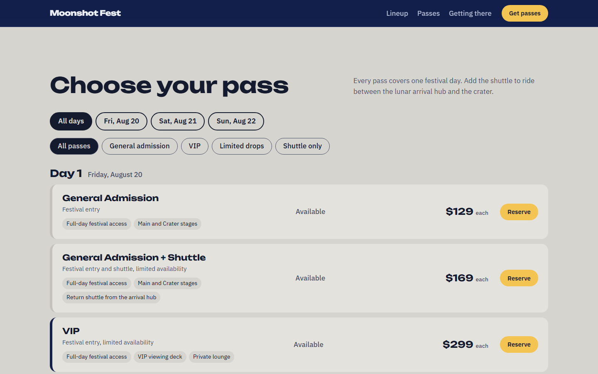
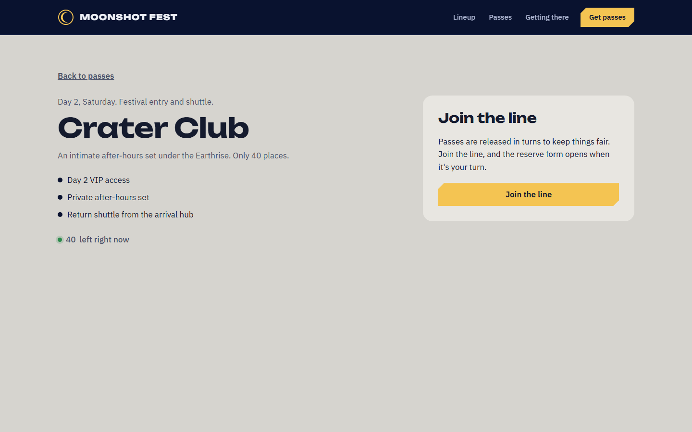
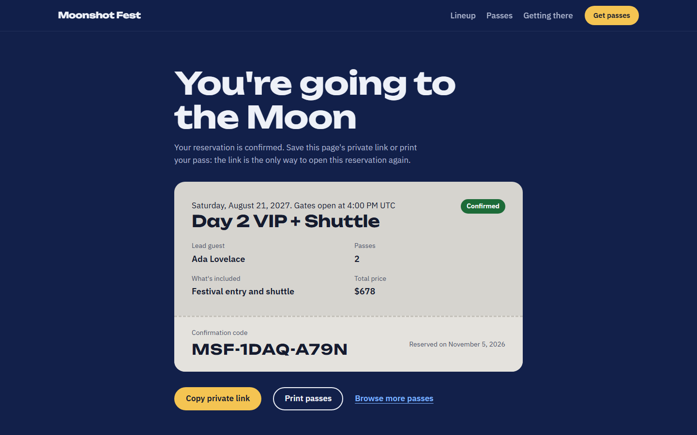
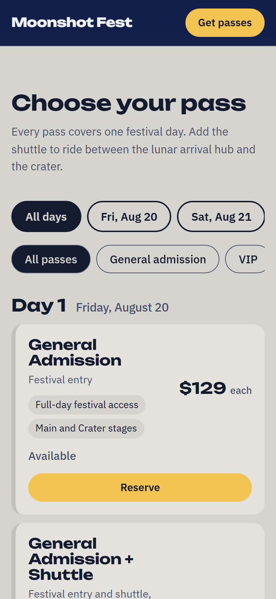
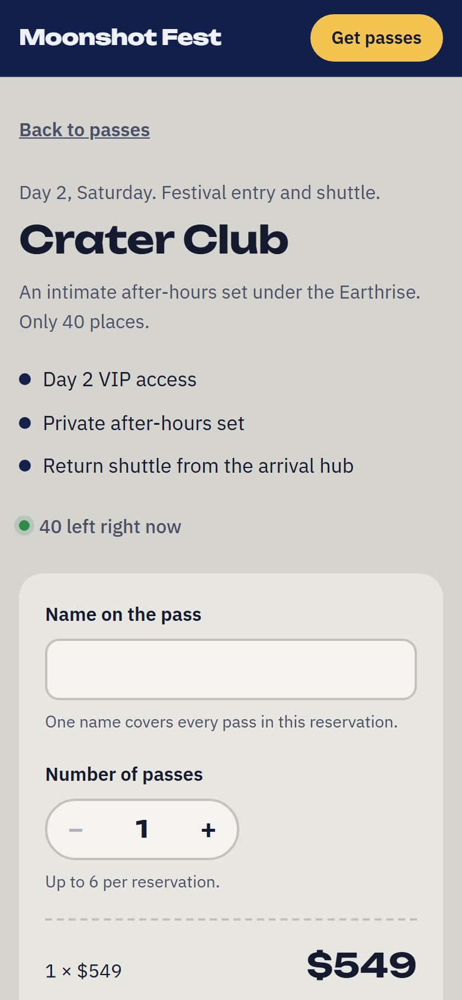
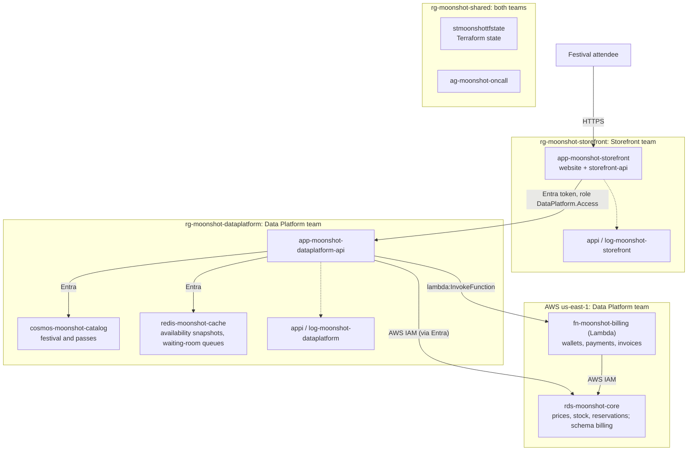
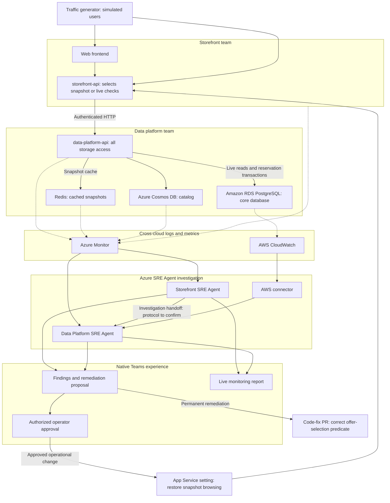

# moonshot-fest

## Waiting-room migration demo

`infra/queue-scenario.json` controls the standard queue that new guests join and
the Data Platform's `ADMISSION_QUEUES` value. The baseline uses
`waitingroom-standard` for both. The simulator creates a normal commit on `main`
that changes both values to `waiting-room-perf-improved`, then dispatches **Deploy
data platform** on main. It waits for that exact run to succeed before dispatching
**Deploy storefront**. Checkout pauses while a deployment request is running,
then resumes; a failed request does not block the next one.
There is no expected-commit input or deployment pin. Ordinary
pushes do not deploy; the simulator explicitly dispatches the existing workflows.

After both deployments, new guests join the improved queue. Existing tickets
still reference the original queue, which remains in the Storefront worker
policy but is no longer admitted by the Data Platform. The resulting backlog
and `QUEUE_NOT_CONFIGURED` failures are the incident evidence. Adding the
original queue to the Data Platform allowlist permits its waiting guests to
progress; preserve that mitigation in source to avoid Terraform reverting it.
The simulator has only two repeatable buttons: add another 500 customers and
deploy the incident. Each click returns immediately and queues new work. It has
no Reset function or persisted demo state. Only temporary in-memory tracking is
kept; a restart forgets pending work and does not replay it. Live queue entries,
purchases, and GitHub runs remain in their own services.

Restore baseline source and deploy it manually when needed. The simulator never
force-pushes history, deletes Redis entries, or moves tickets. Its deployment
credential needs Contents and Actions read/write. A failed operation does not
block another button click; a new request can create another cloud run.

Seeded simulator customers poll their tickets and purchase one pass when
admitted, using generated Luhn-valid Moonshot Wallet IDs and stable reservation
idempotency keys. Waiting customers never bypass admission. Checkout follows
the existing Storefront/Data Platform payment path and includes request/trace
headers for downstream correlation. Verify AWS invoice logs independently;
simulator booking confirmations alone do not prove invoice delivery.

Limited drops remain visible and their `waitingroom-drops` queue is always
admitted, independently of this standard-queue migration. Drop visibility is
not an incident signal.

A fictional three-day music festival on the Moon, built as a standalone
ticket-booking application and an Azure SRE Agent demo.

**Try it live: <https://app-moonshot-storefront.azurewebsites.net>**

The product is named **moonshot-fest**; the shared repository is
`sanchitmehta/moonshot-concert`. Two teams own independently deployable parts: the
Storefront team (website and storefront-api) and the Data Platform team
(data-platform-api and all storage). Each has its own folder, Terraform root, Azure
resource group, monitoring and deployment workflow.

[Product](#customer-experience) |
[Screenshots](#screenshots) |
[Code layout](#repository-structure) |
[Local development](#local-development) |
[Cloud architecture](#cloud-architecture) |
[Incident demo](#planned-incident) |
[Delivery plan](#delivery-plan) |
[Open decisions](#open-design-decisions)

## Current status

| Area | Status |
| --- | --- |
| Product requirements | Agreed; remaining questions listed under [open decisions](#open-design-decisions) |
| Local application | Working end to end: website, storefront-api and data-platform-api with PostgreSQL, Redis and the Cosmos DB emulator, started by Aspire |
| Cloud environment | Live at <https://app-moonshot-storefront.azurewebsites.net>: deployed to Azure by Terraform and GitHub Actions; see [cloud architecture](#cloud-architecture) |
| Incident demo | Planned; no defective release or agent integration yet |

Locally and in Azure, the product is verified in a browser on desktop and mobile:
browse, reserve, retry safely, reopen the private confirmation, and keep reservations
across restarts. In Azure every hop signs in with Microsoft Entra and each team's
telemetry reaches its own Application Insights. The incident pieces below are still plans.

## Screenshots

The festival landing page and the booking site are one page: hero, lineup, limited
drops, and every pass grouped by day.



| Lineup | Limited drops with live counts |
| --- | --- |
|  |  |
| **Passes grouped by day** | **Reserve** |
|  |  |
| **Private confirmation** | |
|  | |

On a phone:

<p>
  
  
  
</p>

These are from the live Azure site. To refresh them, in `storefront\web` set `SITE_URL`
to the website (local or Azure) and `CONFIRMATION_PATH` to a confirmation link path, then
run `npm run screenshots`. It uses the installed Microsoft Edge.

## Customer experience

| Screen | Features |
| --- | --- |
| Festival home | Festival dates, location, lineup, and countdown |
| Explore packages | Day, access-tier, and shuttle filters; prices and package inclusions |
| Waiting room | Join the line for a pass, see your place and the estimated wait, and get a 10-minute turn to reserve |
| Reserve | Enter the lead name, choose a guest quantity, review the total, and pay with a Moonshot Wallet ID |
| Confirmation | View the lead name, reserved pass details and wallet payment, save a private confirmation link, and print the pass on one page |
| Invoice | Open the invoice for the reservation from the confirmation page, and print it or save it as a PDF |

```text
Discover the festival -> Compare packages -> Wait your turn -> Reserve and pay -> Save confirmation
```

### Agreed V1 scope

- One three-day festival, not a multi-festival marketplace.
- Twelve standard offers: three days, General Admission or VIP, with or without
  an included shuttle.
- Two exclusive-drop packages, each with its own inventory and sale window.
- Three standalone shuttle-only offers, one per day, with no festival admission
  included. The initial catalog therefore contains 17 offers in total.
- Independently preallocated stock per offer, including shuttle bundles.
- Guest booking, with one package per reservation and no shopping cart.
- One lead name covers the reservation; individual guest names and email
  addresses are not required.
- Every offer permits 1-6 passes per reservation, including exclusive drops.
- Protected, read-only confirmation access. A booking reference alone must not
  grant access.
- Dark, festival-first lunar styling.

Guests pay with the Moonshot Wallet they collected at the Moonshot Earth Centre: a
wallet ID such as `MSW-1234-5678` (the last digit is a Luhn check digit). Every
wallet starts with $100,000 and each reservation is debited from it. Customer
accounts, three-day passes, cancellations, refunds and booking changes are not
included in V1. Reservations are simulated; no real tickets, travel or money
change hands.

Shuttle is fictional return transport between a lunar arrival hub and the
festival venue, not Earth-to-Moon travel. Customers can buy it with admission or
in a separate shuttle-only reservation. There are no routes, schedules, or seat
selection in V1. Allocate shuttle capacity between bundles and standalone offers
upfront so the same capacity is not sold twice.

### Product vocabulary

| Term | Meaning |
| --- | --- |
| Festival | Dates, venue, the three festival days and the lineup |
| Offer | Anything a guest can buy, shown on the website as a pass: price, sale window, stock and what it includes |
| Limited drop | An exclusive offer with its own small allocation, identified by `saleType = LIMITED_DROP` |
| Reservation | One lead name, one offer and 1-6 passes at the validated price, paid from one Moonshot Wallet |
| Waiting room | The line every guest joins before reserving. Each sale type has its own queue; the Storefront admits a set number of guests per minute |
| Moonshot Wallet | The guest's festival wallet. Balance, payments and invoices are kept by Moonshot Billing, a Data Platform service in AWS |
| Availability | Remaining stock, sale status, and whether the count is a `SNAPSHOT` or `LIVE` read |

`limitedAvailability` is a merchandising flag that shows the "limited availability"
badge. Standard offers can have it too: it is true for every offer except the three
General Admission ticket-only offers. It does not make an offer a limited drop.

The full contract is in [`data-platform/api/openapi.yaml`](data-platform/api/openapi.yaml);
services, settings and telemetry are in [`docs/service-map.md`](docs/service-map.md).

The UI should distinguish upcoming sales, open sales, sold-out offers, and
closed sales. Snapshot availability must not be presented as a live count.
Unavailable services or rejected reservations should produce an explicit message,
not a false confirmation.

If a live refresh fails, the UI may retain the last available snapshot only with
its observation time, a snapshot label, and a visible refresh warning. If no
snapshot is available, show availability temporarily unavailable rather than a
fabricated zero or sold-out state. The live-read failure must remain observable;
reservation submission still validates authoritative inventory and price.

## Repository structure

```text
moonshot-concert\
  storefront\
    web\                React + TypeScript website (Storefront team)
    api\                Node.js + TypeScript storefront API (Storefront team)
  data-platform\
    api\                Node.js + TypeScript data-platform API: catalog, inventory,
                        availability, waiting room (Data Platform team)
    billing\            Moonshot Billing, AWS Lambda fn-moonshot-billing: wallets,
                        payments and invoices (Data Platform team)
    insights\           Kusto analytics (later phase)
  apphost\              Aspire AppHost for local development only
  infra\                Terraform: bootstrap, shared, storefront and data-platform roots
  .github\workflows\    CI on every push; manual Deploy shared, data platform, storefront
  docs\                 Service map and operational documentation
```

The application does not depend on Aspire. Each service reads standard
environment variables and runs on its own; the AppHost only starts containers and
supplies those variables locally.

These are responsibility boundaries. Keep each API independently runnable and
deployable. Folder separation does not enforce separate repository-read
permissions for agents.

Use this root README as the shared overview. Add folder-level documentation when
there are actual setup commands or implementation details to explain; do not
duplicate the product requirements in each folder.

The traffic generator from PR #1 will move into `traffic-generator\` in
coordination with its author. Demo-only operations live in a separate repository.

## Team ownership

| Storefront team | Data Platform team | Shared |
| --- | --- | --- |
| Website and storefront-api | data-platform-api and its OpenAPI contract | Terraform state and bootstrap identities |
| Customer workflows and offer selection | All persistence and caching logic | On-call action group; later the SRE Agents |
| Selection of offers needing live availability | Snapshot and live-availability reads | Demo traffic and scenarios (separate repository) |
| `infra\storefront`, `rg-moonshot-storefront`, its telemetry | `infra\data-platform`, `rg-moonshot-dataplatform`, its telemetry | `infra\shared`, `rg-moonshot-shared` |

**Only the data-platform-api accesses storage.** The storefront-api never connects directly
to Redis, Cosmos DB, or PostgreSQL and receives no database credentials.
It consumes a pinned version of the data-platform-api contract rather than copying
internal database models.

## Local development

```text
Browser -> storefront-web (Vite) -> storefront-api -> data-platform-api -> PostgreSQL, Redis, Cosmos DB emulator
```

### Prerequisites

- Node.js 24 or later (the APIs run TypeScript directly with Node's type stripping)
- Docker Desktop, running
- [Aspire CLI](https://aspire.dev) 13.5 or later

### Run everything

```powershell
cd storefront\web;      npm install; cd ..\..
cd storefront\api;      npm install; cd ..\..
cd data-platform\api;   npm install; cd ..\..
cd apphost;             npm install; aspire run
```

Aspire starts PostgreSQL (with a data volume), Redis and the Cosmos DB emulator in
containers, seeds the festival, then starts both APIs and the website once their
dependencies are healthy. Open the `storefront-web` URL from the Aspire dashboard.
The dashboard also shows logs, traces and metrics from both APIs.

Reservations persist across restarts in the PostgreSQL volume. Seeding is
idempotent: existing stock and reservations are kept. The first limited drop is on
sale from the first seed; the second opens 24 hours later.

If your network blocks nuget.org, add an untracked `apphost\nuget.config` that points
at your package feed before running `aspire add` or `aspire run`.

### Without Aspire

The application does not depend on Aspire. Each service runs with `npm start` and
the environment variables listed in the [service map](docs/service-map.md), for
example `DATABASE_URL`, `REDIS_URL` and `COSMOS_CONNECTION_STRING` for the
data-platform-api, and `DATA_PLATFORM_API_URL` for the storefront-api. Run
`npm run seed` in `data-platform\api` once against a new database.

### Checks

| Folder | Command | Covers |
| --- | --- | --- |
| `data-platform\api` | `npm run check`, `npm test` | Types; reservation rules against PostgreSQL (set `TEST_DATABASE_URL`), including concurrent bookings that must not oversell; Entra token and app-role checks; PostgreSQL token sign-in settings |
| `data-platform\billing` | `npm run check`, `npm test`, `npm run build` | Types; wallet IDs; charges, idempotency, insufficient funds and invoices against PostgreSQL (set `TEST_DATABASE_URL`); the Lambda bundle |
| `storefront\api` | `npm run check`, `npm test` | Types; which passes get live availability and how a failed live refresh degrades; waiting-room policy, admission worker and waiting-room routes |
| `storefront\web` | `npm run build` | Types and production build |

### Rules the implementation keeps

- Only Data Platform services touch storage. The storefront-api uses the
  data-platform-api's OpenAPI contract and holds no database credentials.
- Reservations need a waiting-room admission, used once. The data-platform-api
  checks sale window, price, quantity and stock and holds the passes, then
  Moonshot Billing charges the wallet and issues the invoice in one transaction.
  A refused payment cancels the hold; a reservation is charged at most once.
  Remaining stock is calculated from the reservations table.
- Reservation requests carry an `Idempotency-Key`. Retrying returns the original
  reservation; the website keeps the key until it gets an answer.
- The private confirmation link carries an access key in the URL fragment. Only
  its hash is stored; the confirmation code alone opens nothing.
- Local development runs without service-to-service authentication
  (`AUTH_MODE=none`), which the data-platform-api only accepts on a loopback
  address. In Azure (`AUTH_MODE=entra`) it requires a Microsoft Entra token with
  the `DataPlatform.Access` app role, held only by the storefront-api's identity.
- In the cloud no service uses keys or passwords: Cosmos DB, Redis and the RDS
  core database accept only the data-platform-api's managed identity (RDS through
  an AWS IAM role that trusts it).

## Cloud architecture

Everything in Azure and AWS is Terraform in [`infra\`](infra/README.md), deployed by GitHub
Actions. Each team owns one resource group, its own monitoring and its own deployment identity,
and can change nothing outside its group. The Data Platform is multi-cloud: its API, catalog and
cache run in Azure and its core database runs in AWS. No service uses keys or passwords: every
hop signs in with Microsoft Entra or with AWS IAM tokens obtained through it.



| Area | Resource | Where |
| --- | --- | --- |
| Website and storefront-api | App Service `app-moonshot-storefront` (one origin) | `rg-moonshot-storefront` |
| data-platform-api | App Service `app-moonshot-dataplatform-api` | `rg-moonshot-dataplatform` |
| Festival and pass catalog | Cosmos DB `cosmos-moonshot-catalog` (serverless) | `rg-moonshot-dataplatform` |
| Prices, inventory and reservations | Amazon RDS for PostgreSQL `rds-moonshot-core`, database `core` | AWS account, us-east-1 |
| Wallets, payments and invoices | Lambda `fn-moonshot-billing`, schema `billing` in the same database | AWS account, us-east-1 |
| Availability cache and waiting-room queues | Managed Redis `redis-moonshot-cache` | `rg-moonshot-dataplatform` |
| Storefront telemetry | `log-moonshot-storefront`, `appi-moonshot-storefront` | `rg-moonshot-storefront` |
| Data Platform telemetry | `log-moonshot-dataplatform`, `appi-moonshot-dataplatform` | `rg-moonshot-dataplatform` |
| On-call notifications | Action group `ag-moonshot-oncall` | `rg-moonshot-shared` |
| Terraform state | Storage `stmoonshottfstate`, one container per root | `rg-moonshot-shared` |
| API-to-API sign-in | Entra app role `DataPlatform.Access`, granted only to the storefront-api's identity | Tenant |

Workloads run in South Central US, the closest region with App Service quota in this
subscription; resource groups, identities and state are in East US 2. The Data Platform
team also owns an AWS account, deployed from the same Terraform root; see
[infra/README.md](infra/README.md#aws-data-platform), including how to change the AWS account.

### Deploying

| Workflow | Trigger | What it does |
| --- | --- | --- |
| **CI** | Every push to `main` | Tests and builds both teams' code, plans every Terraform root |
| **Deploy shared** | Manual | Applies the shared root |
| **Deploy data platform** | Manual | Applies the Data Platform root, then deploys and verifies the data-platform-api |
| **Deploy storefront** | Manual | Applies the Storefront root, then deploys and verifies the website and storefront-api |

GitHub Actions signs in with OIDC (no secrets) as each team's own identity. See
[infra/README.md](infra/README.md) for the full topology, identities and runbooks.

## Planned incident

### Primary scenario: wrong availability selection

An application release introduces live availability for exclusive drops.
During offer selection, it mistakenly uses `limitedAvailability` instead of
`saleType === "LIMITED_DROP"`.

Ordinary tickets also have finite inventory. When the live-count feature
activates during a sale, the wrong filter selects ordinary offers as well.
The storefront-api requests too many live checks from the data-platform-api, bypassing its
snapshot cache for those reads and increasing inventory-database load.

Redis and the data-platform-api need not be faulty. The incident is an application-side
request-amplification regression. Database pressure and customer latency must be
demonstrated with real telemetry, not assumed or fabricated. Cosmos load may
remain stable while PostgreSQL reads increase.

### Immediate mitigation and permanent fix

The original team plan uses an operator-approved App Service setting change to
force snapshot browsing as the primary immediate mitigation. A code-fix PR
corrects offer selection for longer-term remediation. These are complementary
actions, not a choice between operational recovery and fixing the defect.

Snapshot responses must be labeled honestly, and reservations must still validate
authoritative inventory and price. The setting affects browsing, not reservation
correctness.

A storefront-api slot rollback was also discussed as an alternative recovery
option. It does not replace the original setting-change plan. Exact setting
semantics, approval scope, and any fallback rollback procedure remain
[open decisions](#open-design-decisions). None is implemented yet.

### Alternative scenario: injected Redis fault

The original proposal also retains an injected Redis fault as an alternative
incident. Keep this as a separate, controlled scenario rather than conflating it
with the application regression, where Redis remains healthy.

The specific fault, expected telemetry, and safe recovery procedure still need
to be defined. Forcing snapshot mode is not automatically a remedy for a Redis
outage; the primary scenario's mitigation must not be assumed to fix this one.

### Presentation flow

The incident can start before the presentation. Creating the Live Report is the
planned live action. The walkthrough should retain the investigation evidence,
agent handoff, proposed operational change, operator approval in native Teams,
and recovery monitoring.

### End-to-end demo workflow

This complements the product architecture above. It shows the planned traffic,
telemetry, investigation, approval, remediation, and reporting flow, not
implemented integrations.



## Azure SRE Agent capabilities showcased

- **Multi-agent investigation:** the Storefront SRE Agent investigates customer
  symptoms and collaborates with the Data Platform SRE Agent. A2A is proposed;
  the meeting recap does not conclusively confirm the handoff protocol.
- **AWS connector:** access AWS CloudWatch telemetry alongside Azure Monitor
  logs and metrics. This is not communication with an AWS agent through A2A.
- **Cross-cloud telemetry correlation:** connect customer-facing latency to
  snapshot/live request modes, cache behavior, and database load using both
  Azure and AWS logs and metrics. Findings and recovery claims need supporting
  evidence from these signals.
- **Native Teams integration:** present findings, remediation proposals, and
  operator approvals in Teams.
- **Approval-based remediation:** require operator approval for operational
  changes and propose a permanent code fix.
- **Live Reports:** generate a monitoring report from investigation evidence and
  telemetry, then verify recovery under continued traffic.
- **Service context:** provide agents with a service map, ownership information,
  source locations, and deployment history without supplying the root cause.

These are planned demo capabilities, not a claim that the scenario is
implemented in this repository.

## Traffic generator

### Reproduce demo latency with one command

From the repository root, with Python 3 installed, copy and run this command.
No extra packages, application deployment, or code changes are needed.
Use it only when you are authorized to send traffic to the demo app.

```powershell
python traffic_generator.py --base-url https://app-moonshot-storefront.azurewebsites.net --users ((1..100 | ForEach-Object { "demo-$_" }) -join ',') --until-stopped --interval 0.01 --concurrency 100 --confirm-authorized-target
```

This rotates 100 synthetic demo IDs and sends up to 100 requests per second,
with at most 100 requests in flight,
to the live demo's `/api/offers`. **It continues through errors, timeouts, and
slow responses until you press Ctrl+C.** Keep the terminal open and monitor the
demo. Ctrl+C stops new requests, drains active calls, prints a summary, and exits
with code 130. Each request has a five-second socket timeout; a timeout frees
capacity for the next scheduled request rather than stopping the run.

You control the amounts: change `1..100` for the number of demo IDs,
`--concurrency 100` for the maximum active requests, and `--interval 0.01` for
the global spacing between request starts (target rate = `1 / interval`).
There are no hard-coded upper limits on concurrency, request rate, or duration.
Concurrency must be a positive integer; interval and duration must be positive,
finite numbers. The client machine and target service still have resource limits.
High settings can exhaust either system. Monitor the run and use Ctrl+C to stop.

The earlier five-request-per-second test produced brief slow responses and three
client timeouts, but another run stayed mostly fast. The stronger command above
has not yet been verified to produce sustained, browser-visible delays. It does
not guarantee latency or downtime. It does not change the existing feature flag
or increase traffic automatically.

Watch the pass listings on <https://app-moonshot-storefront.azurewebsites.net>
while the command runs. The terminal prints each request's elapsed time and a
latency summary. In Azure Portal, open `appi-moonshot-storefront` > Performance
and inspect requests to `/api/offers` for server-side evidence. After traffic
stops, verify that `/health/ready` and `/api/offers` respond normally; stopping
the pinger alone does not prove recovery.

### Normal traffic and options

The generator defaults to the real `GET /api/offers` storefront endpoint. Each
request lists passes and triggers live-availability enrichment when
`LIVE_AVAILABILITY_ENABLED=true`. On a healthy release, only on-sale limited
drops get live reads that bypass Redis and query PostgreSQL. Setting
`LIVE_AVAILABILITY_ENABLED=false` disables those live reads and uses snapshots
(Redis first, database on a cache miss). The pinger does not change application
flags or deploy code. Latency and timeouts alone do not prove a database bottleneck.

Requests default to sequential execution as rotating demo IDs. `X-Demo-User` is a synthetic
header for the generator; the application does not authenticate or otherwise
process it.

```powershell
python traffic_generator.py `
  --base-url https://app-moonshot-storefront.azurewebsites.net `
  --users demo-1,demo-2,demo-3 `
  --duration 60 `
  --interval 1 `
  --confirm-authorized-target
```

Use `--path` to select another storefront API endpoint, or repeat it to cycle
through endpoints. Use only with systems you are authorized to test.
Local HTTP targets are allowed; other targets must use HTTPS. Redirects are not
followed.

Request rate and concurrency are separate limits. The interval applies across all
workers, not to each worker: `0.01` permits at most 100 request starts per second.
With `--concurrency 100`, if all 100 requests take five seconds, throughput
falls to roughly 20 requests per second; the pinger does not add more workers to
maintain the target rate. Network and scheduling overhead can also reduce the
actual rate. Demo IDs only label requests; they do not create authenticated
sessions or change application behavior. Without `--until-stopped`, the run uses
`--duration` (default 60 seconds), with no maximum duration.
`--until-stopped` has no time limit and cannot be combined with `--duration`.
Slow responses reduce throughput rather than creating a backlog or catch-up burst.

Timed mode stops new requests on the first HTTP error (including redirects),
transport error, timeout, or response taking at least three seconds.
Manual-stop mode reports those conditions but continues sending traffic. Already
started requests drain; the tool does not cancel server-side work. Responses
are read up to 1 MiB; larger responses count as an error (manual-stop mode continues).
Latency includes
body transfer. The summary reports p50, p95, and maximum elapsed time for the last
10,000 completed requests, including failed attempts. Total request and failure
counts cover the entire run. This limits memory use during long runs. A failed
or slow timed run exits with code 1. No flag changes or automatic traffic
escalation occur.

Run the local pinger regression checks without sending live traffic:

```powershell
python -B -m unittest test_traffic_generator.py
```

## Delivery plan

Each milestone must produce a working result before the next adds dependencies.

| Milestone | Expected result | Status |
| --- | --- | --- |
| 1. Working local product | Four customer screens, separate APIs, persistent retry-safe reservations, protected confirmations | Done |
| 2. Cloud environment | Both teams deployed to Azure by Terraform and GitHub Actions, Entra-only sign-in, storage reachable only by the data-platform-api | Done |
| 2b. Waiting room, wallet and multi-cloud Data Platform | Waiting-room queues and admissions, Moonshot Wallet payments, core database on Amazon RDS with IAM sign-in through the managed identity | Done |
| 3. Caching and observability | Redis snapshots, explicit snapshot and live reads, correlated traces and logs per team, measurable request and database activity | Working locally and in Azure; dashboards and alerts planned |
| 4. Repeatable incident | Healthy and defective releases, concurrent load, the approved mitigation path, verified recovery | Planned |
| 5. Agent demonstration | Independently scoped SRE Agents, cross-cloud investigation, Teams approval, evidence-backed Live Report | Planned |
| 6. Business analytics | Reservation events into Kusto with a ticket-sales dashboard, owned by Data Platform | Planned |

Future deployment work must preserve the separate application and data
identities and permissions. Demo-only scenario tooling lives in a separate
repository; demo-specific fault injection must not be mixed into ordinary
customer workflows.

## Open design decisions

| Topic | What remains to be decided |
| --- | --- |
| Mitigation | Exact snapshot-override behavior, approval scope, and any fallback slot-rollback procedure |
| Alternative Redis fault | Controlled fault, expected signals, and a recovery procedure appropriate to that fault |
| Agent handoff | Confirm the collaboration protocol and required configuration |
| Kusto hosting | Azure Data Explorer cluster or Fabric Eventhouse, and SRE Agent connector support |
| AWS connector | SRE Agent AWS connector setup for the core database's CloudWatch logs and metrics |

Keep agreed requirements above stable while these questions are resolved.
