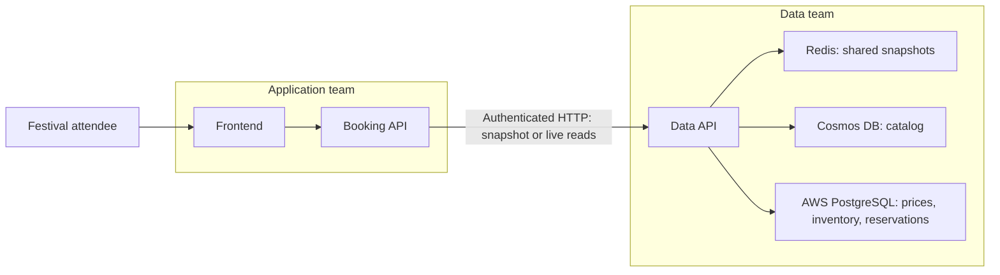

# moonshot-fest

A fictional three-day music festival on the Moon, built as a standalone
ticket-booking application and an Azure SRE Agent demo.

The product is named **moonshot-fest**; the shared repository is
`sanchitmehta/moonshot-concert`. Application, data platform, and demo operations
live in separate folders, with independently deployable frontend and APIs.

[Product](#customer-experience) |
[Code layout](#repository-structure) |
[Local development](#local-first-implementation) |
[Cloud architecture](#planned-cloud-architecture) |
[Incident demo](#planned-incident) |
[Delivery plan](#delivery-plan) |
[Open decisions](#open-design-decisions)

## Current status

| Area | Status |
| --- | --- |
| Product requirements | Core scope agreed; remaining questions listed under [open decisions](#open-design-decisions) |
| Repository foundation | Folder placeholders and this overview are present |
| Local application | Planned; no runnable frontend, APIs, or database in this checkout |
| Cloud environment and incident demo | Planned; no provisioned resources or agent integration |

Application implementation is paused while customer requirements are refined.
This README is the project overview, not evidence that the planned features work.

The first implementation will run locally with SQLite. Redis, Cosmos DB, AWS,
cloud authentication, and SRE Agent integration follow later. The local version
must not be presented as a completed cross-cloud demo.

## Customer experience

| Screen | Planned features |
| --- | --- |
| Festival home | Festival dates, location, lineup, and countdown |
| Explore packages | Day, access-tier, and shuttle filters; prices and package inclusions |
| Reserve | Choose one package and a guest quantity, review the total, and confirm a simulated reservation |
| Confirmation | View booking details and save a private confirmation link |

```text
Discover the festival -> Compare packages -> Reserve as a guest -> Save confirmation
```

### Agreed V1 scope

- One three-day festival, not a multi-festival marketplace.
- Twelve standard offers: three days, General Admission or VIP, with or without
  an included shuttle.
- Two exclusive-drop packages, each with its own inventory and sale window.
- Independently preallocated stock per offer, including shuttle bundles.
- Guest booking, with one package per reservation and no shopping cart.
- Protected, read-only confirmation access. A booking reference alone must not
  grant access.
- Dark, festival-first lunar styling.

No payments, customer accounts, three-day passes, cancellations, or booking
changes are included in V1. Reservations are simulated; no real tickets or
travel are sold.

### Product vocabulary

| Term | Meaning |
| --- | --- |
| Package | A festival experience, such as a day pass or an exclusive backstage experience |
| Offer | A purchasable package variant with a price, sale window, and preallocated inventory |
| Exclusive drop | A special package with its own inventory, identified by `promotionType = LIMITED_DROP` |
| Reservation | A confirmed quantity of one offer at the validated price |

Finite inventory does not make an offer an exclusive drop. Standard and
exclusive offers can both have `isLimitedInventory = true`.

The UI should distinguish upcoming sales, open sales, sold-out offers, and
closed sales. Snapshot availability must not be presented as a live count.
Unavailable services or rejected reservations should produce an explicit message,
not a false confirmation.

## Repository structure

```text
moonshot-concert\
  application\
    web\                React + TypeScript customer experience
    booking-api\        Node.js + TypeScript customer workflows
  data-platform\
    data-access-api\    Node.js + TypeScript storage and caching interface
    database\           SQLite setup and seeds; future cloud migrations and seeds
    contracts\          Data-team-owned versioned OpenAPI contract
  demo-ops\             Local orchestration, infrastructure, traffic, and dashboards
```

These are responsibility boundaries, not completed implementations. Keep each
API independently runnable and the frontend independently deployable. Folder
separation does not enforce separate repository-read permissions for agents.

Use this root README as the shared overview. Add folder-level documentation when
there are actual setup commands or implementation details to explain; do not
duplicate the product requirements in each folder.

The pending traffic generator remains at its existing path; moving it into
`demo-ops` will require coordination with its contributor.

## Team ownership

| Application team | Data team | Shared demo operations |
| --- | --- | --- |
| Frontend and Booking API | Data API and OpenAPI contract | Environment setup and infrastructure definitions |
| Customer workflows and offer selection | All persistence and caching logic | Bounded synthetic traffic |
| Selection of offers needing live availability | Snapshot and live-availability reads | Dashboards and repeatable demo setup |
| Application telemetry | Database and cache telemetry | Scenario orchestration |

**Only the Data API accesses storage.** The Booking API never connects directly
to SQLite, Redis, Cosmos DB, or PostgreSQL and receives no database credentials.
It consumes a pinned version of the Data API contract rather than copying
internal database models.

## Local-first implementation

The initial product will use React and TypeScript for the frontend, Node.js and
TypeScript for both APIs, and a SQLite database owned exclusively by the Data API.
Frontend, Booking API, and Data API will run as separate local processes without
Azure or AWS credentials.

```text
Browser -> Web frontend -> Booking API -> Data Access API -> SQLite
```

SQLite will initially store the catalog, prices, inventory, and reservations.
Reservations must validate authoritative price and inventory, update stock
atomically, and support retry-safe submissions. Cached or previously displayed
availability is never sufficient to confirm a reservation.

Local authentication must be explicitly development-only. It must not silently
replace the planned cloud identity model.

There are no install or startup commands for the application yet. The local
implementation should eventually provide one documented entry point under
`demo-ops` to start the three processes and seed a new database. Normal restarts
must preserve reservations rather than silently reset stock.

The first local acceptance check is a browser booking that traverses both APIs,
decrements persistent stock exactly once, and can be reopened through its private
confirmation link after a restart. Local SQLite alone does not demonstrate the
Redis or cross-cloud incident.

## Planned cloud architecture

| Area | Target |
| --- | --- |
| Frontend | Independent deployment; hosting details to be finalized |
| Booking API and Data API | Separate Azure App Service applications |
| API-to-API authentication | Microsoft Entra tokens using the Booking API's managed identity |
| Festival and package catalog | Azure Cosmos DB |
| Prices, inventory, and reservations | AWS PostgreSQL |
| Shared cached summaries | Data-team-owned Redis |

These targets are design choices, not provisioned resources.



## Planned incident

An application release introduces live availability for exclusive drops.
During offer selection, it mistakenly uses `isLimitedInventory` instead of
`promotionType === "LIMITED_DROP"`.

Ordinary tickets also have finite inventory. When the live-count feature
activates during a sale, the wrong filter selects ordinary offers as well.
The Booking API requests too many live checks from the Data API, bypassing its
snapshot cache for those reads and increasing inventory-database load.

Redis and the Data API need not be faulty. The incident is an application-side
request-amplification regression. Database pressure and customer latency must be
demonstrated with real telemetry, not assumed or fabricated. Cosmos load may
remain stable while PostgreSQL reads increase.

The team meeting and existing demo plan propose an operator-approved App Service
setting change that forces snapshot browsing as immediate mitigation, followed
by a code-fix PR. Snapshot responses must be labeled honestly, and reservations
must still validate authoritative inventory and price.

A Booking API slot rollback was also discussed. The final mitigation playbook
and setting semantics are [open decisions](#open-design-decisions), not
implemented recovery mechanisms.

The incident can start before the presentation. Creating the Live Report is the
planned live action.

## Azure SRE Agent capabilities showcased

- **Multi-agent investigation:** the Application SRE Agent investigates customer
  symptoms and collaborates with the Data Platform SRE Agent. A2A is proposed;
  the meeting recap does not conclusively confirm the handoff protocol.
- **AWS connector:** access AWS CloudWatch telemetry alongside Azure Monitor
  logs and metrics. This is not communication with an AWS agent through A2A.
- **Native Teams integration:** present findings, remediation proposals, and
  operator approvals in Teams.
- **Approval-based remediation:** require operator approval for operational
  changes and propose a permanent code fix.
- **Live Reports:** generate a monitoring report from investigation evidence and
  telemetry, then verify recovery under continued traffic.
- **Service context:** provide agents with a service map, ownership information,
  source locations, and deployment history without supplying the root cause.

These are planned demo capabilities, not a claim that the scenario is
implemented in this repository.

## Traffic generator

The traffic generator is introduced in
[PR #1](https://github.com/sanchitmehta/moonshot-concert/pull/1). Until that PR is
merged, use its branch to run the command below.

Send bounded, sequential `GET` requests to API paths as rotating demo users.
The `X-Demo-User` header identifies each simulated user; it does not authenticate
users. The paths below are examples, not implemented application endpoints.

```powershell
python traffic_generator.py `
  --base-url https://your-demo-app.example.com `
  --path /api/offers `
  --path /api/availability `
  --users demo-1,demo-2,demo-3 `
  --duration 60 `
  --interval 1 `
  --confirm-authorized-target
```

Use only with systems you are authorized to test. The tool sends one request at
a time, requires at least one second between requests, stops after five minutes,
and does not follow redirects. Local HTTP targets are allowed; other targets
must use HTTPS.

## Delivery plan

Each milestone must produce a working result before the next adds dependencies.
None of these implementation milestones is complete yet.

| Milestone | Expected result |
| --- | --- |
| 1. Working local product | Four customer screens, separate APIs, seeded SQLite, persistent retry-safe reservations, and protected confirmations |
| 2. Cloud data adapters | Data API uses Cosmos DB and AWS PostgreSQL without exposing storage access to the application |
| 3. Caching and observability | Data-owned Redis, explicit snapshot/live behavior, correlated traces and logs, and measurable request and database activity |
| 4. Repeatable incident | Healthy and regressed application releases, bounded traffic, an approved mitigation path, and verified recovery |
| 5. Agent demonstration | Independently scoped SRE Agents, cross-cloud investigation, Teams approval, and an evidence-backed Live Report |

Future deployment work must preserve the separate application and data
identities and permissions. Infrastructure and scenario tooling belong in
`demo-ops`; demo-specific fault injection must not be mixed into ordinary
customer workflows.

## Open design decisions

| Topic | What remains to be decided |
| --- | --- |
| Guest details | Whether a simulated reservation needs any contact information |
| Quantity limits | Maximum guests per reservation, including any tighter exclusive-drop limit |
| Festival content | Final dates, lineup, package names, prices, inventory allocations, and sale windows |
| Frontend hosting | Where to deploy the independently built web frontend |
| Mitigation | Primary setting override versus slot rollback, exact setting behavior, and approval scope |
| Agent handoff | Confirm the collaboration protocol and required configuration |

Keep agreed requirements above stable while these questions are resolved. Cloud
accounts, regions, networking, and resource sizing are deployment inputs to
confirm before provisioning, not prerequisites for the initial local product.
