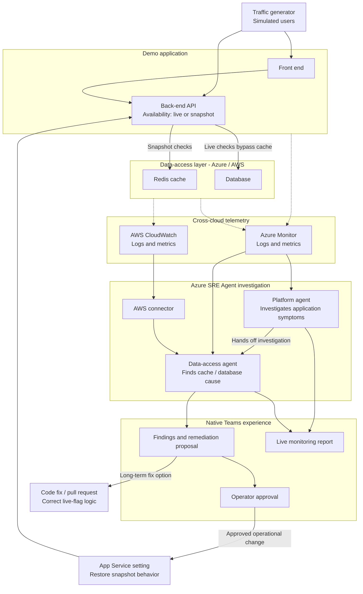

# Ignite Azure SRE Agent demo

## Scenario

Simulated users browse a flash-sale application spanning Azure and AWS. A faulty availability flag bypasses Redis for all offers, increases database load, and slows the back-end API. A platform agent investigates the symptoms and hands off to a data-access agent to correlate logs and metrics across clouds. The agents propose an App Service setting change for immediate mitigation and a code fix for longer-term remediation. An operator approves the operational change through native Teams, and a live report shows the investigation and recovery.

An injected Redis fault is an alternative incident. The incident can start before the presentation; creating the live report is the planned live action.

## Azure SRE Agent capabilities showcased

- **Multi-agent investigation:** a platform agent hands off to a data-access agent. A2A is a potential handoff mechanism, but the recap does not confirm that protocol.
- **AWS Connector:** access AWS CloudWatch telemetry alongside Azure Monitor logs and metrics. The planned AWS integration uses the connector, not A2A communication with an AWS agent.
- **Native Teams integration:** present findings, remediation proposals, and operator approvals in Teams.
- **Approval-based remediation:** require operator approval before changing the App Service setting; also propose a code fix or pull request.
- **Live Reports:** generate a live monitoring report from investigation evidence and telemetry.
- **Cross-cloud telemetry correlation:** connect application latency to cache behavior and database load using Azure and AWS logs and metrics.

These are planned demo capabilities, not a claim that the complete scenario is implemented here.

## Traffic generator

The traffic generator is introduced in [PR #1](https://github.com/sanchitmehta/moonshot-concert/pull/1). Until that PR is merged, use its branch to run the command below.

Send bounded, sequential `GET` requests to API paths as rotating demo users. The `X-Demo-User` header identifies each simulated user; it does not authenticate users.

```powershell
python traffic_generator.py `
  --base-url https://your-demo-app.example.com `
  --path /api/offers `
  --path /api/availability `
  --users demo-1,demo-2,demo-3 `
  --duration 60 `
  --interval 1 `
  --confirm-authorized-target
```

Use only with systems you are authorized to test. The tool sends one request at a time, requires at least one second between requests, stops after five minutes, and does not follow redirects. Local HTTP targets are allowed; other targets must use HTTPS.

## Planned demo architecture

The scenario combines flash-sale traffic, cross-cloud investigation, and approval-based remediation. This diagram describes the planned demo, not components already implemented in this repository.



**Primary failure:** code sets the live flag for all offers. Requests bypass Redis, increase database load, and raise API latency. An App Service setting provides immediate mitigation.

**Alternative failure:** an injected Redis fault. Exact Azure/AWS resource placement remains open. AWS telemetry uses the planned connector, not A2A.
