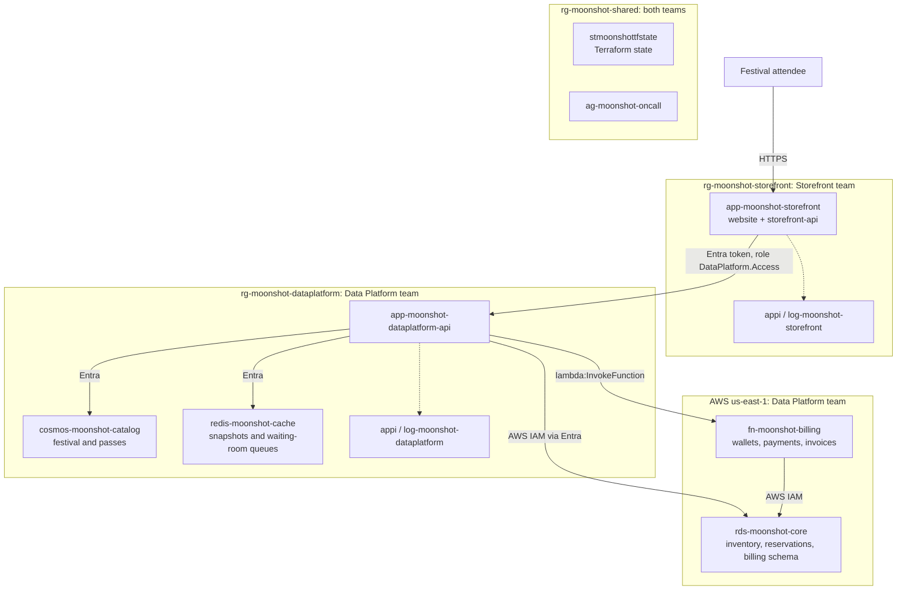

# Moonshot Fest

A ticket-booking application for a three-day music festival in Tycho Crater on
the Moon.

The product is named **Moonshot Fest**; the repository is
`sanchitmehta/moonshot-concert`. Two teams own independently deployable parts:
the Storefront team owns the website and storefront-api; the Data Platform team
owns data-platform-api, billing and all storage. Each team has its own Terraform
root, Azure resource group, monitoring and deployment workflow.

[Customer experience](#customer-experience) |
[Screenshots](#screenshots) |
[Code layout](#repository-structure) |
[Local development](#local-development) |
[Cloud architecture](#cloud-architecture) |
[Deployment](#deployment)

## Customer experience

| Screen | Features |
| --- | --- |
| Festival home | Festival dates, location, lineup, and countdown |
| Explore packages | Day, access-tier, and shuttle filters; prices and package inclusions |
| Waiting room | Join the line for a pass, see your place and estimated wait, and get a 10-minute turn to reserve |
| Reserve | Enter the lead name, choose a guest quantity, review the total, and pay with a Moonshot Wallet ID |
| Confirmation | View the lead name, reserved pass details and wallet payment, save a private confirmation link, and print the pass on one page |
| Invoice | Open the reservation invoice from the confirmation page, and print it or save it as a PDF |

```text
Discover the festival -> Compare packages -> Wait your turn -> Reserve and pay -> Save confirmation
```

### Product scope

- One three-day festival, not a multi-festival marketplace.
- Twelve standard offers: three days, General Admission or VIP, with or without
  an included shuttle.
- Two exclusive-drop packages, each with its own inventory and sale window.
- Three standalone shuttle-only offers, one per day, with no festival admission
  included. The initial catalog contains 17 offers in total.
- Independently preallocated stock per offer, including shuttle bundles.
- Guest booking, with one package per reservation and no shopping cart.
- One lead name covers the reservation; individual guest names and email
  addresses are not required.
- Every offer permits 1–6 passes per reservation, including exclusive drops.
- Protected, read-only confirmation access. A booking reference alone does not
  grant access.
- Dark, festival-first lunar styling.

Guests pay with the Moonshot Wallet collected at the Moonshot Earth Centre:
a wallet ID such as `MSW-1234-5678` (the last digit is a Luhn check digit).
Every wallet starts with $100,000, and each reservation is debited from it.
Customer accounts, three-day passes, cancellations, refunds and booking changes
are not included.

The shuttle is return transport between a lunar arrival hub and the festival
venue, not Earth-to-Moon travel. Customers can buy it with admission or in a
separate shuttle-only reservation. There are no routes, schedules, or seat
selection. Allocate shuttle capacity between bundles and standalone offers
upfront so the same capacity is not sold twice.

### Product vocabulary

| Term | Meaning |
| --- | --- |
| Festival | Dates, venue, the three festival days and the lineup |
| Offer | Anything a guest can buy, shown on the website as a pass: price, sale window, stock and what it includes |
| Limited drop | An exclusive offer with its own small allocation, identified by `saleType = LIMITED_DROP` |
| Reservation | One lead name, one offer and 1–6 passes at the validated price, paid from one Moonshot Wallet |
| Waiting room | The line every guest joins before reserving. Each sale type has its own queue; the Storefront controls admission |
| Moonshot Wallet | The guest's festival wallet. Balance, payments and invoices are kept by Moonshot Billing, a Data Platform service in AWS |
| Availability | Remaining stock, sale status, and whether the count is a `SNAPSHOT` or `LIVE` read |

The full contract is in
[`data-platform/api/openapi.yaml`](data-platform/api/openapi.yaml).
Services, settings, telemetry and error codes are in the
[service map](docs/service-map.md).

The UI distinguishes upcoming sales, open sales, sold-out offers, and closed
sales. Snapshot availability must not be presented as a live count.
Unavailable services or rejected reservations produce an explicit message,
not a false confirmation.

If a live refresh fails, the UI may retain the last available snapshot only
with its observation time, a snapshot label, and a visible refresh warning.
If no snapshot is available, show availability temporarily unavailable rather
than a fabricated zero or sold-out state. The live-read failure remains
observable; reservation submission still validates authoritative inventory
and price.

## Screenshots

The landing page and booking site are one page: hero, lineup, limited drops,
and passes grouped by day.


| Lineup | Limited drops with live counts |
| --- | --- |
|  |  |
| **Passes grouped by day** | **Reserve** |
|  |  |
| **Private confirmation** | |
|  | |

On a phone:

<p>
  
  
  
</p>

To refresh screenshots, in `storefront\web` set `SITE_URL` to the website
and `CONFIRMATION_PATH` to a confirmation link path, then run
`npm run screenshots`. The script uses the installed Microsoft Edge.
Use a reservation created for documentation, not a customer's private link.

## Repository structure

```text
moonshot-concert\
  storefront\
    web\                React + TypeScript website
    api\                Node.js + TypeScript storefront API
  data-platform\
    api\                Node.js + TypeScript API: catalog, inventory,
                        availability, waiting room
    billing\            AWS Lambda: wallets, payments and invoices
  apphost\              Aspire AppHost for local development
  infra\                Terraform: bootstrap, shared, storefront and data-platform
  .github\workflows\    CI and manual deployment workflows
  docs\                 Service map, architecture page, health queries and product screenshots
```

Each service reads standard environment variables and runs independently.
The AppHost starts containers and supplies those variables locally; the
application does not depend on Aspire.

## Team ownership

| Storefront team | Data Platform team | Shared |
| --- | --- | --- |
| Website and storefront-api | data-platform-api and its OpenAPI contract | Terraform state and bootstrap identities |
| Customer workflows and offer selection | All persistence and caching logic; Moonshot Billing | On-call action group |
| `infra\storefront`, `rg-moonshot-storefront`, its telemetry | `infra\data-platform`, `rg-moonshot-dataplatform`, its telemetry and AWS resources | `infra\shared`, `rg-moonshot-shared` |

The storefront-api never connects directly to Redis, Cosmos DB, or PostgreSQL
and receives no database credentials. It consumes the data-platform-api
contract rather than copying internal database models. Only Data Platform
services touch storage, and only billing accesses the `billing` schema.

## Local development

```text
Browser -> storefront-web (Vite) -> storefront-api -> data-platform-api -> PostgreSQL, Redis, Cosmos DB emulator
```

### Prerequisites

- Node.js 24 or later; the APIs run TypeScript directly with Node's type stripping.
- Docker Desktop, running.
- [Aspire CLI](https://aspire.dev) 13.5 or later.

### Run everything

```powershell
cd storefront\web;      npm install; cd ..\..
cd storefront\api;      npm install; cd ..\..
cd data-platform\api;   npm install; cd ..\..
cd data-platform\billing; npm install; cd ..\..
cd apphost;             npm install; aspire run
```

Aspire starts PostgreSQL with a data volume, Redis and the Cosmos DB emulator,
seeds the festival, then starts the local billing server, APIs and website
after their dependencies are healthy. Open the `storefront-web` URL from the Aspire dashboard.
The dashboard also shows logs, traces and metrics from both APIs.

Reservations persist across restarts in the PostgreSQL volume. Seeding is
idempotent: existing stock and reservations are kept. The first limited drop
is on sale from the first seed; the second opens 24 hours later.

If your network blocks nuget.org, add an untracked `apphost\nuget.config`
that points at your package feed before running `aspire add` or `aspire run`.

### Without Aspire

The APIs run with `npm start` and the environment variables listed in
the [service map](docs/service-map.md), for example `DATABASE_URL`,
`REDIS_URL` and `COSMOS_CONNECTION_STRING` for the data-platform-api, and
`DATA_PLATFORM_API_URL` for the storefront-api. Run `npm run seed` in
`data-platform\api` once against a new database. For local billing, run
`npm run start:local` in `data-platform\billing` with `DATABASE_URL` set to
the same database, and set the data-platform-api's `BILLING_URL` to that server.

### Checks

| Folder | Command | Covers |
| --- | --- | --- |
| `data-platform\api` | `npm run check`, `npm test` | Types; reservations against PostgreSQL (`TEST_DATABASE_URL`), concurrent bookings, Entra token and app-role checks, PostgreSQL token sign-in settings |
| `data-platform\billing` | `npm run check`, `npm test`, `npm run build` | Types; wallet IDs, charges, idempotency, insufficient funds and invoices against PostgreSQL (`TEST_DATABASE_URL`); Lambda bundle |
| `storefront\api` | `npm run check`, `npm test` | Types; live availability and refresh failures; waiting-room policy, admission worker and routes |
| `storefront\web` | `npm run build` | Types and production build |
| `apphost` | `npm run build`, `npm run lint` | AppHost types and lint rules |

### Reservation and access rules

- Reservations require a waiting-room admission, used once. The Data Platform
  checks the sale window, price, quantity and stock, then holds the passes.
  Moonshot Billing charges the wallet and issues the invoice in one transaction.
  A refused payment cancels the hold; each reservation is charged at most once.
  Remaining stock is calculated from reservations.
- Requests carry an `Idempotency-Key`. Retrying returns the original
  reservation; the website keeps the key until it gets an answer.
- Private confirmation links carry an access key in the URL fragment.
  Only its hash is stored; the confirmation code alone grants no access.
- Local development uses `AUTH_MODE=none`, accepted only on a loopback address.
  In Azure, `AUTH_MODE=entra` requires a Microsoft Entra token with the
  `DataPlatform.Access` app role, held by the storefront-api's identity.
  Only `POST /v1/admin/restock`, which resets stock for demo rehearsals, takes
  `DataPlatform.Admin` instead, held by the demo simulator's identity.
- Cloud services use managed identities and short-lived tokens. The
  data-platform-api signs in to Cosmos DB and Redis with Entra, and to RDS
  through an AWS IAM role. Billing uses its own IAM role and database user.

## Cloud architecture

Infrastructure is defined in [Terraform](infra/README.md) and deployed by
GitHub Actions. The Data Platform is multi-cloud: its API, catalog and cache
run in Azure; its core database and billing function run in AWS.



Workloads run in South Central US; resource groups, identities and Terraform
state are in East US 2. AWS resources run in us-east-1.
The [infrastructure guide](infra/README.md) lists resources, identities,
bootstrap requirements, database setup and troubleshooting.
[docs/architecture.html](docs/architecture.html) draws the same services with
every connection, how each one signs in and where its telemetry goes; open the
file in a browser from a clone.

## Deployment

| Workflow | Trigger | What it does |
| --- | --- | --- |
| **CI** | Every push to `main` | Tests and builds both teams' code, plans every Terraform root |
| **Deploy shared** | Manual | Applies the shared root |
| **Deploy data platform** | Manual | Applies the Data Platform root, uploads billing code, then deploys and verifies the API |
| **Deploy storefront** | Manual | Applies the Storefront root, then deploys and verifies the website and storefront-api |

Run the manual deployment workflows from `main`, the default branch. GitHub
Actions signs in with OIDC as each team's deployment identity, which bootstrap
already trusts for `main`. Make every change on `main`, by pull request.
Ordinary source pushes do not deploy either service. Database setup is a
separate manual operation; see the [deployment runbook](infra/README.md#deploying).

Waiting-room settings are owned by each service's Terraform root:
`WAITING_ROOM_POLICY` in `infra/storefront/main.tf` and `ADMISSION_QUEUES` in
`infra/data-platform/main.tf`. Standard passes use `waitingroom-standard`;
limited drops use `waitingroom-drops`.

Both APIs expose readiness, liveness and version endpoints. OpenTelemetry
traces, logs and metrics go to the Aspire dashboard locally and each team's
Application Insights in Azure. Billing logs and Lambda metrics go to
CloudWatch. See the [service map](docs/service-map.md#telemetry) for signals
and [health checks](docs/service-map.md#health-and-version), and the
[health queries](docs/health-queries.md) for the queries the teams run against
them.
