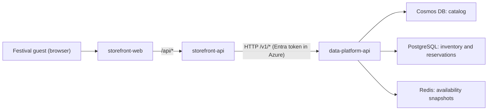

# Moonshot Fest service map

Moonshot Fest sells single-day passes for a three-day music festival in Tycho Crater
on the Moon. Two teams own its services.

## Request flow

## Services

| Service | Owner | Code | Responsibility |
| --- | --- | --- | --- |
| storefront-web | Storefront team | `storefront/web` | Festival website: home, passes, reserve, confirmation |
| storefront-api | Storefront team | `storefront/api` | Website API. Filters passes, decides which passes show live remaining counts, forwards reservations. Serves the built website in Azure |
| data-platform-api | Data Platform team | `data-platform/api` | System of record for the catalog, stock and reservations. The only service that touches storage |

The storefront-api depends on the data-platform-api contract in
`data-platform/api/openapi.yaml`. It never connects to a database or cache.

## Data stores (owned by Data Platform)

| Store | Local | Cloud | Holds |
| --- | --- | --- | --- |
| Catalog | Cosmos DB emulator | Cosmos DB `cosmos-moonshot-catalog` | Festival, lineup and pass descriptions (database `moonshot`, container `catalog`) |
| Inventory | PostgreSQL container | PostgreSQL `psql-moonshot-inventory` | Prices, sale windows, stock allocations and reservations (database `inventory`) |
| Availability cache | Redis container | Managed Redis `redis-moonshot-cache` | Short-lived stock snapshots per pass (`offer-stock:v1:{offerId}`) |

Remaining stock is calculated from the reservations table: allocation minus the sum of
reserved quantities. In Azure, all three stores accept only the data-platform-api's
managed identity; see [infra/README.md](../infra/README.md).

## Availability reads

| Read | Path | Source |
| --- | --- | --- |
| Snapshot | `GET /v1/offers`, `GET /v1/offers/{id}`, `GET /v1/offers/{id}/availability` | Redis first; on a miss, PostgreSQL, then cached for `AVAILABILITY_CACHE_TTL_SECONDS` |
| Live | `GET /v1/offers/{id}/availability?freshness=live` | Always PostgreSQL |

The storefront-api requests live availability only for passes with
`saleType = LIMITED_DROP` that are on sale, and only when `LIVE_AVAILABILITY_ENABLED=true`.
Every other pass shows its snapshot. Reservations always recheck stock and price in a
single PostgreSQL transaction, whatever the website showed.

## Configuration

| Variable | Service | Purpose |
| --- | --- | --- |
| `LIVE_AVAILABILITY_ENABLED` | storefront-api | `true` shows live counts for on-sale limited drops; `false` serves snapshots for every pass |
| `LIVE_AVAILABILITY_CONCURRENCY` | storefront-api | Maximum parallel live-availability calls per request (default 4) |
| `DATA_PLATFORM_API_URL` | storefront-api | Base URL of the data-platform-api |
| `DATA_PLATFORM_API_SCOPE` | storefront-api | Azure only: token scope for the data-platform-api (`api://<client ID>/.default`) |
| `WEB_DIST_DIR` | storefront-api | Built website to serve (Azure) |
| `DATABASE_URL`, `DATABASE_POOL_MAX` | data-platform-api | PostgreSQL connection and pool size (default 10) |
| `DATABASE_AUTH` | data-platform-api | `password` (local) or `entra` (managed identity token as the PostgreSQL password) |
| `REDIS_URL`, `REDIS_AUTH` | data-platform-api | Redis connection; `REDIS_AUTH=entra` signs in with the managed identity |
| `COSMOS_CONNECTION_STRING` or `COSMOS_ENDPOINT`, `COSMOS_DATABASE` | data-platform-api | Emulator connection string locally; account endpoint with managed identity in Azure |
| `COSMOS_CREATE` | data-platform seed | `false` in Azure, where Terraform creates the database and container |
| `AVAILABILITY_CACHE_TTL_SECONDS` | data-platform-api | Snapshot lifetime (default 15) |
| `AUTH_MODE` | data-platform-api | `none` for local development only (loopback address); `entra` in Azure |
| `ENTRA_TENANT_ID`, `ENTRA_AUDIENCES`, `ENTRA_REQUIRED_ROLE` | data-platform-api | Accepted tokens: tenant, audiences (client ID and `api://` URI), required app role (default `DataPlatform.Access`) |
| `AZURE_CLIENT_ID` | both APIs | Azure only: the service's user-assigned managed identity |
| `OTEL_EXPORTER_OTLP_ENDPOINT`, `OTEL_SERVICE_NAME` | all APIs | OpenTelemetry export (Aspire locally) |
| `APPLICATIONINSIGHTS_CONNECTION_STRING` | all APIs | Azure only: sends traces, metrics and logs to Application Insights instead of OTLP |

## Health and version

Both APIs expose `GET /health/live`, `GET /health/ready` and `GET /version`.
Readiness checks every dependency: the data-platform-api checks PostgreSQL, Redis and
Cosmos DB; the storefront-api checks the data-platform-api.

## Telemetry

Both APIs emit OpenTelemetry traces (HTTP, PostgreSQL, Redis) and metrics: to the Aspire
dashboard locally, and to each team's own Application Insights in Azure
(`appi-moonshot-storefront`, `appi-moonshot-dataplatform`).

| Metric | Service | Attributes |
| --- | --- | --- |
| `availability.reads` | data-platform-api | `freshness` (SNAPSHOT, LIVE), `cache` (hit, miss, error, bypass) |
| `storefront.live_availability.requests` | storefront-api | `outcome` (success, failure) |
| `storefront.live_availability.checks_per_listing` | storefront-api | Histogram of live calls per pass listing |

Logs never contain lead names, access keys or idempotency keys.

## Error codes

All errors use `{ code, message, requestId }`.

| Code | Status | Meaning |
| --- | --- | --- |
| `OFFER_NOT_FOUND` | 404 | Unknown pass |
| `NOT_ON_SALE` | 409 | Outside the pass's sale window |
| `INSUFFICIENT_STOCK` | 409 | Not enough passes left |
| `PRICE_CHANGED` | 409 | Price differs from the one the guest saw |
| `QUANTITY_NOT_ALLOWED` | 422 | More than the per-reservation limit |
| `IDEMPOTENCY_KEY_REUSED` | 422 | Same key, different reservation |
| `RESERVATION_NOT_FOUND` | 404 | Unknown code or wrong access key |
| `INVALID_REQUEST` | 400 | Malformed request |
| `UNAUTHORIZED` | 401 | data-platform-api: missing or invalid Entra token (Azure) |
| `FORBIDDEN` | 403 | data-platform-api: token lacks the `DataPlatform.Access` role (Azure) |
| `SERVICE_UNAVAILABLE` | 503 | storefront-api could not reach the data-platform-api |
