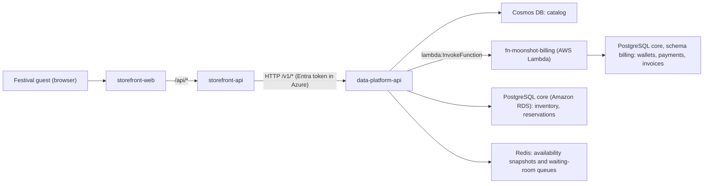

# Moonshot Fest service map

Moonshot Fest sells single-day passes for a three-day music festival in Tycho Crater
on the Moon. Two teams own its services.

## Request flow

## Services

| Service | Owner | Code | Responsibility |
| --- | --- | --- | --- |
| storefront-web | Storefront team | `storefront/web` | Festival website: home, passes, waiting room, reserve and pay, confirmation |
| storefront-api | Storefront team | `storefront/api` | Website API. Filters passes, decides which passes show live remaining counts, owns the waiting-room policy and admits guests, forwards reservations. Serves the built website in Azure |
| data-platform-api | Data Platform team | `data-platform/api` | System of record for the catalog, stock, reservations and waiting-room queues. Runs in Azure; its core database runs in AWS |
| Moonshot Billing (`fn-moonshot-billing`) | Data Platform team | `data-platform/billing` | Charges Moonshot Wallets and issues invoices. An AWS Lambda function invoked only by the data-platform-api; no HTTP endpoint |

The storefront-api depends on the data-platform-api contract in
`data-platform/api/openapi.yaml`. It never connects to a database or cache. Only Data Platform
services touch storage, and only billing touches the `billing` schema.

## Data stores (owned by Data Platform)

| Store | Local | Cloud | Holds |
| --- | --- | --- | --- |
| Catalog | Cosmos DB emulator | Cosmos DB `cosmos-moonshot-catalog` | Festival, lineup and pass descriptions (database `moonshot`, container `catalog`) |
| Core | PostgreSQL container | Amazon RDS for PostgreSQL `rds-moonshot-core` (AWS, us-east-1) | Database `core`. Schema `public` (data-platform-api): prices, sale windows, stock allocations, reservations. Schema `billing` (billing): Moonshot Wallets, payments, invoices |
| Cache and queues | Redis container | Managed Redis `redis-moonshot-cache` | Short-lived stock snapshots per pass (`offer-stock:v1:{offerId}`) and waiting-room queues (`waitingroom:{queue}:*`) |

Remaining stock is calculated from the reservations table: allocation minus the sum of
reserved quantities (confirmed reservations, and unpaid ones still within their hold). In the
cloud, every store accepts only the data-platform-api's managed identity: Cosmos DB and Redis
directly, and RDS through an AWS IAM role that trusts it; see [infra/README.md](../infra/README.md).

## Waiting room

Every reservation goes through the waiting room.

1. The guest joins: the storefront-api picks the queue for the pass's sale type from
   `WAITING_ROOM_POLICY` and adds the guest to it (`POST /v1/queues/{queue}/entries`). The
   browser keeps an opaque ticket and polls its place in line every 5 seconds.
2. For each queue in the policy, every `everySeconds`, the storefront-api's admission worker asks
   the Data Platform to admit the next `admitCount` guests from that queue
   (`POST /v1/queues/{queue}/admissions`). Each tick uses an
   idempotency key, so a retry admits nobody twice. The default policy admits up to 5 standard
   guests and 1 limited-drop guest every 10 seconds.
3. An admitted guest has `ADMISSION_MINUTES` (10) to reserve. The reservation carries the
   admission; the Data Platform checks it and uses it once.

Standard passes use `waitingroom-standard`; limited drops use `waitingroom-drops`.
The Data Platform stores queues generically. The Storefront owns the mapping
between a pass's sale type and its queue.
The Data Platform restricts standard-queue admission requests to queues listed in
`ADMISSION_QUEUES`. If the setting is unset, it accepts admission requests for any valid queue.
The fixed `waitingroom-drops` queue always permits admission requests.

`WAITING_ROOM_POLICY` is configured in `infra/storefront/main.tf`.
`ADMISSION_QUEUES` is configured independently in `infra/data-platform/main.tf`.
Queue names in existing tickets do not change when these settings are deployed.
Storefront adds a built-in `waitingroom-drops` policy (one admission every ten
seconds) when the setting contains only standard queues. Existing explicit
limited-drop entries remain supported.
Standard-only settings require this default-aware Storefront version. Before
rolling back to an older version, restore an explicit limited-drop entry.

## Moonshot Wallet

Guests pay with the Moonshot Wallet collected at the Moonshot Earth Centre. A wallet ID looks
like `MSW-1234-5678`; its last digit is a Luhn check digit. Any well-formed wallet starts with
$100,000 on first use. Only a hash of the wallet ID and its last four digits are stored.

## Moonshot Billing

Billing (`fn-moonshot-billing`, an AWS Lambda function in the core database's VPC) keeps wallets,
payments and invoices. The data-platform-api invokes it directly with its AWS role; nothing else
can. It has two actions:

| Action | Event | Result |
| --- | --- | --- |
| `charge` | `{ reservationId, walletId, billedTo, lines: [{ description, quantity, unitPrice }] }` | `{ paymentId, invoiceNumber, walletLast4, amount, balanceAfter, paidAt }` |
| `getInvoice` | `{ invoiceNumber }` | `{ invoiceNumber, issuedAt, reservationId, billedTo, lines, total, payment }` |

Billing returns refusals (`WALLET_INVALID`, `INSUFFICIENT_FUNDS`, `INVOICE_NOT_FOUND`) as
`{ ok: false, error }`, so the Lambda `Errors` metric counts only real failures. The wallet
debit, the payment (`PAY-XXXXXXXXXX`) and the invoice (`INV-YYYY-NNNNNN`) are written in one
transaction, and a reservation is charged at most once: a repeated charge returns the original.

A reservation is paid in three steps:

1. The data-platform-api holds the passes (`PENDING_PAYMENT`). The hold counts against stock for
   `RESERVATION_HOLD_MINUTES` (120) from the moment the reservation is created.
2. It asks billing to charge the wallet for the reservation.
3. Paid: the reservation is `CONFIRMED` with the payment and invoice. Refused: it is
   `CANCELLED`, the passes return to stock and the waiting-room admission can be used again.
   Billing unreachable: it stays pending and the guest's retry with the same `Idempotency-Key`
   charges at most once.

A reservation is confirmed only while its hold lasts. Once the hold runs out the passes return to
stock, so the hold is kept longer than `ADMISSION_MINUTES`: a guest can retry for as long as
their admission allows.

The guest opens the invoice from the confirmation page
(`GET /v1/reservations/{code}/invoice` with the reservation's access key).

## Availability reads

| Read | Path | Source |
| --- | --- | --- |
| Snapshot | `GET /v1/offers`, `GET /v1/offers/{id}`, `GET /v1/offers/{id}/availability` | Redis first; on a miss, PostgreSQL, then cached for `AVAILABILITY_CACHE_TTL_SECONDS` |
| Live | `GET /v1/offers/{id}/availability?freshness=live` | Always PostgreSQL |

The storefront-api requests live availability only for passes with
`saleType = LIMITED_DROP` that are on sale, and only when `LIVE_AVAILABILITY_ENABLED=true`.
Every other pass shows its snapshot. Reservations always recheck stock and price in a
single PostgreSQL transaction, whatever the website showed.

## Configuration

| Variable | Service | Purpose |
| --- | --- | --- |
| `LIVE_AVAILABILITY_ENABLED` | storefront-api | `true` shows live counts for on-sale limited drops; `false` serves snapshots for every pass |
| `LIVE_AVAILABILITY_CONCURRENCY` | storefront-api | Maximum parallel live-availability calls per request (default 4) |
| `DATA_PLATFORM_API_URL` | storefront-api | Base URL of the data-platform-api |
| `DATA_PLATFORM_API_SCOPE` | storefront-api | Azure only: token scope for the data-platform-api (`api://<client ID>/.default`) |
| `WAITING_ROOM_POLICY` | storefront-api | JSON list of `{ queue, saleType, admitCount, everySeconds }`: the queue each sale type joins (the first listed), every queue the admission worker drains, and how many guests each queue admits per interval. Drops use the built-in policy when omitted. |
| `WEB_DIST_DIR` | storefront-api | Built website to serve (Azure) |
| `DATABASE_URL`, `DATABASE_POOL_MAX` | data-platform-api | PostgreSQL connection and pool size (default 10) |
| `DATABASE_AUTH` | data-platform-api | `password` (local), `entra` (Azure Database for PostgreSQL) or `aws-iam` (Amazon RDS IAM token signed with AWS credentials obtained with the managed identity) |
| `DATABASE_CA_FILE`, `DATABASE_ADMIN_SECRET_ARN` | data-platform-api | RDS only: CA bundle for TLS, and the RDS-managed administrator secret used to create the IAM database user |
| `AWS_REGION`, `AWS_ROLE_ARN`, `AWS_FEDERATION_RESOURCE` | data-platform-api | RDS only: region, the AWS role to assume, and the Entra resource whose token AWS STS accepts |
| `ADMISSION_MINUTES` | data-platform-api | How long an admitted guest has to reserve (default 10) |
| `RESERVATION_HOLD_MINUTES` | data-platform-api | How long an unpaid reservation holds its passes (default 120) |
| `BILLING_FUNCTION` or `BILLING_URL` | data-platform-api | Billing's Lambda function (`fn-moonshot-billing`, invoked with the AWS role) or, locally, its development server |
| `BILLING_DATABASE_USER` | data-platform database setup | Billing's IAM database user to create (default `billing_fn`) |
| `DATABASE_URL`, `DATABASE_AUTH` | billing | Core database connection; `aws-iam` signs in as `billing_fn` with the function's role |
| `ADMISSION_QUEUES` | data-platform-api | JSON allowlist for admission requests, except that `waitingroom-drops` is always admitted; unset permits all valid queues |
| `REDIS_URL`, `REDIS_AUTH` | data-platform-api | Redis connection; `REDIS_AUTH=entra` signs in with the managed identity |
| `COSMOS_CONNECTION_STRING` or `COSMOS_ENDPOINT`, `COSMOS_DATABASE` | data-platform-api | Emulator connection string locally; account endpoint with managed identity in Azure |
| `COSMOS_CREATE` | data-platform seed | `false` in Azure, where Terraform creates the database and container |
| `AVAILABILITY_CACHE_TTL_SECONDS` | data-platform-api | Snapshot lifetime (default 15) |
| `AUTH_MODE` | data-platform-api | `none` for local development only (loopback address); `entra` in Azure |
| `ENTRA_TENANT_ID`, `ENTRA_AUDIENCES`, `ENTRA_REQUIRED_ROLE` | data-platform-api | Accepted tokens: tenant, audiences (client ID and `api://` URI), required app role (default `DataPlatform.Access`) |
| `AZURE_CLIENT_ID` | both APIs | Azure only: the service's user-assigned managed identity |
| `OTEL_EXPORTER_OTLP_ENDPOINT`, `OTEL_SERVICE_NAME` | all APIs | OpenTelemetry export (Aspire locally) |
| `APPLICATIONINSIGHTS_CONNECTION_STRING` | all APIs | Azure only: sends traces, metrics and logs to Application Insights instead of OTLP |

## Health and version

Both APIs expose `GET /health/live`, `GET /health/ready` and `GET /version`.
Readiness checks every dependency: the data-platform-api checks PostgreSQL (`database`),
Redis (`cache`, `queues`) and Cosmos DB (`catalog`); the storefront-api checks the
data-platform-api.

## Telemetry

Both APIs emit OpenTelemetry traces (HTTP, PostgreSQL, Redis) and metrics: to the Aspire
dashboard locally, and to each team's own Application Insights in Azure
(`appi-moonshot-storefront`, `appi-moonshot-dataplatform`). In Azure the services' log lines
go to Application Insights too, each linked to the request that wrote it; a line that
carries an error is stored as an exception with the line's message in `msg`. A call from the
storefront-api to the data-platform-api is recorded as a dependency and continues the same
trace in the data-platform-api.

| Metric | Service | Attributes |
| --- | --- | --- |
| `availability.reads` | data-platform-api | `freshness` (SNAPSHOT, LIVE), `cache` (hit, miss, error, bypass) |
| `storefront.live_availability.requests` | storefront-api | `outcome` (success, failure) |
| `storefront.live_availability.checks_per_listing` | storefront-api | Histogram of live calls per pass listing |
| `waitingroom.joined`, `waitingroom.admitted`, `waitingroom.waiting` | data-platform-api | `queue` |
| `waitingroom.admission_calls`, `waitingroom.admitted` | storefront-api | `queue` |
| `waitingroom.admission_failures` | storefront-api | `queue`, `upstreamStatus`, `upstreamCode` |

Each API's first log line after a start says what is on sale. `Service started` follows, with
the deployed commit and the settings the service read. The lines the teams read most:

| Log line | Service | Fields |
| --- | --- | --- |
| `Sale is live`, `No passes are on sale` | both APIs | At start-up: `festival`, `passes`, and how many passes are `onSale`, `upcoming`, `soldOut` and `ended` |
| `Service started` | both APIs | `version`, `commit` and the service's settings, once it accepts requests |
| `Request refused` | both APIs | `code`, `status`: a request answered with a 4xx |
| `Passes listed` | storefront-api | `passes` and the sale-status counts, for every listing |
| `Guest joined the line` | storefront-api | `offerId`, `queue`, `entryId`, `position` |
| `Guest joined the waiting room` | data-platform-api | `queue`, `entryId`, `position` |
| `Waiting-room admission` | storefront-api | `queue`, `admitted`, `waiting`, on every tick. The worker lists its queues when it starts |
| `Waiting-room admission failed` | storefront-api | `queue`, `upstreamStatus`, `upstreamCode`: the data-platform-api refused or did not answer |
| `Admitted guests from the waiting room` | data-platform-api | `queue`, `admitted`, `waiting` |
| `Admission queue is not configured` | data-platform-api | `queue`, `waiting`, `oldestJoinedAt`: an admission request it refused |
| `Reservation requested` | both APIs | `offerId`, `quantity`, `queue`, `entryId`. The data-platform-api adds `retry`: whether the idempotency key already has a reservation |
| `Reservation confirmed` | storefront-api | The same fields, `confirmationCode`, `durationMs` |
| `Reservation refused` | storefront-api | The same fields, the refusal's `code`, `durationMs` |
| `Reservation not confirmed` | storefront-api | A warning: the data-platform-api failed or did not answer. The same fields, `code`, `upstreamStatus`, `upstreamCode`, `durationMs` |
| `Passes held` | data-platform-api | `confirmationCode`, `offerId`, `quantity`, `heldUntil`, and the pass's `remaining` stock |
| `Retry resumed a pending reservation` | data-platform-api | `confirmationCode`, `offerId`, `quantity`, `heldUntil`: a repeated request found its unpaid reservation |
| `Retry returned a confirmed reservation` | data-platform-api | `confirmationCode`: a repeated request found its paid reservation |
| `Payment confirmed by billing` | data-platform-api | `confirmationCode`, `paymentId`, `invoiceNumber`, `billingMs`. Billing answers a retry with the original charge, so the line can repeat for one payment |
| `Reservation paid` | data-platform-api | `confirmationCode`, `paymentId`, `invoiceNumber`, `offerId`, `quantity` |
| `Payment refused; reservation cancelled` | data-platform-api | `confirmationCode`, `code` |
| `Billing unavailable; reservation left pending` | data-platform-api | A warning: `confirmationCode` |
| `Payment taken but reservation not confirmed` | data-platform-api | An error with the fields of `Reservation paid`: billing charged the wallet but the reservation could not be confirmed. The line matches the payment to its reservation |
| `Admission used` | data-platform-api | `queue`, `entryId` |
| `Reservation opened`, `Invoice opened` | both APIs | `confirmationCode`, and `invoiceNumber` for an invoice |
| `Availability snapshot refreshed` | data-platform-api | `passes`, `ttlSeconds`: stock read from PostgreSQL after a cache miss |

Billing logs to CloudWatch `/aws/lambda/fn-moonshot-billing`, alongside Lambda's `Invocations`,
`Errors`, `Duration` and `Throttles` metrics. For a charge, `reference` is the reservation's
confirmation code.

| Log line | Fields |
| --- | --- |
| `Billing request` | One per invocation: `action`, `reference`, `outcome`, `code`, `durationMs` |
| `Billing request failed` | An error: `action`, `reference`, `error`, `durationMs` |
| `Wallet charged` | A new charge: `reference`, `paymentId`, `invoiceNumber` |
| `Charge replayed` | A repeated charge answered with the original payment: `reference`, `paymentId`, `invoiceNumber` |
| `Wallet opened` | `reference`: the first charge to a wallet |
| `Billing ready` | `startMs`: a cold start finished |
| `Migration applied` | `version` |

The OpenTelemetry packages in each API stay on the release line that
`@azure/monitor-opentelemetry` depends on; a newer line installs a second copy of the
OpenTelemetry API, and the service's own metrics and logs are then not exported.

Logs never contain lead names, wallet IDs, access keys or idempotency keys.

[health-queries.md](health-queries.md) has the queries the teams run against these signals, and
[architecture.html](architecture.html) shows where each service sends them.

## Error codes

All errors use `{ code, message, requestId }`.

| Code | Status | Meaning |
| --- | --- | --- |
| `OFFER_NOT_FOUND` | 404 | Unknown pass |
| `NOT_ON_SALE` | 409 | Outside the pass's sale window |
| `INSUFFICIENT_STOCK` | 409 | Not enough passes left |
| `PRICE_CHANGED` | 409 | Price differs from the one the guest saw |
| `QUANTITY_NOT_ALLOWED` | 422 | More than the per-reservation limit |
| `IDEMPOTENCY_KEY_REUSED` | 422 | Same key, different reservation |
| `RESERVATION_NOT_FOUND` | 404 | Unknown code or wrong access key |
| `ENTRY_NOT_FOUND` | 404 | Unknown place in line, or the wrong guest key |
| `ADMISSION_REQUIRED` | 403 | Reservation without an admission for this pass (still waiting, or not in line) |
| `ADMISSION_EXPIRED` | 403 | The admission's time to reserve ran out |
| `ADMISSION_USED` | 409 | The admission was already used for a reservation |
| `WALLET_INVALID` | 422 | Malformed Moonshot Wallet ID or wrong check digit |
| `INSUFFICIENT_FUNDS` | 409 | The wallet balance does not cover the total |
| `BILLING_UNAVAILABLE` | 503 | Billing could not be reached; the reservation stays pending and a retry with the same key charges at most once |
| `INVOICE_NOT_FOUND` | 404 | The reservation has no invoice (paid before billing moved to AWS) |
| `INVALID_REQUEST` | 400 | Malformed request |
| `UNAUTHORIZED` | 401 | data-platform-api: missing or invalid Entra token (Azure) |
| `FORBIDDEN` | 403 | data-platform-api: token lacks the `DataPlatform.Access` role (Azure) |
| `SERVICE_UNAVAILABLE` | 503 | storefront-api could not reach the data-platform-api |
